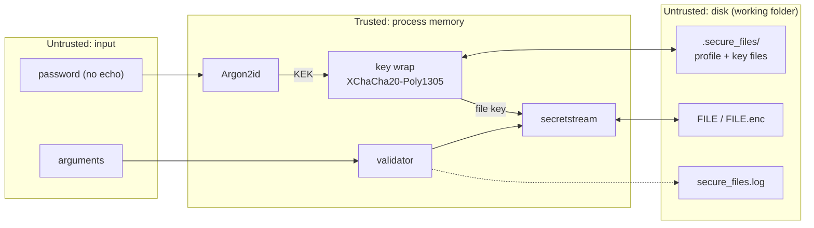

# Architecture and Data Flow

One C17 program (`secure_files/main.c`) using libsodium. Each run executes one command.

## Keys

`password → Argon2id → KEK → unwraps master key (USER.profile) → unwraps file key (USER.keys/ID.key) → decrypts FILE.enc`

* Every file has its own random key. Deleting its key file makes the `.enc` file impossible to decrypt.
* All keys are held in locked memory and wiped after use. Core dumps are disabled.

## Components

* Argument parser and validator: `is_valid_username`, `validate_path`.
* Authentication: `read_password` without echo, Argon2id `MODERATE`.
* Key wrapping: XChaCha20-Poly1305.
* Stream encryption: `crypto_secretstream`, 64 KiB chunks.
* File I/O: `O_NOFOLLOW | O_EXCL`, `fstat` on the file descriptor, owner check.
* Logger.

## On disk

All of these live in `./.secure_files/`: folders `0700`, files `0600`.

| File | Bytes | Contents |
| --- | --- | --- |
| `USER.profile` | 88 | salt 16 + nonce 24 + wrapped master key 32 + tag 16 |
| `USER.keys/ID.key` | 72 | nonce 24 + wrapped file key 32 + tag 16 (the AD is the `.enc` header) |
| `FILE.enc` | 44 + data | `SF01` (4) + file ID (16) + secretstream header (24) = 44 B. Encrypted 64 KiB chunks follow. Each chunk includes a 17-byte tag |

## Trust boundaries

User input. Local disk. Other local users. Process memory.

## Flows

* **init**: password ×2 → Argon2id → KEK → wrap a random MEK → profile.
* **encrypt**: validate → open the input → password → unwrap MEK → new file key → wrap it into the `.key` file → stream to `.enc` → overwrite and remove the original.
* **decrypt**: the reverse of the encrypt process.
* **shred**: password → overwrite and remove the `.key` file → overwrite and remove the `.enc` file.
