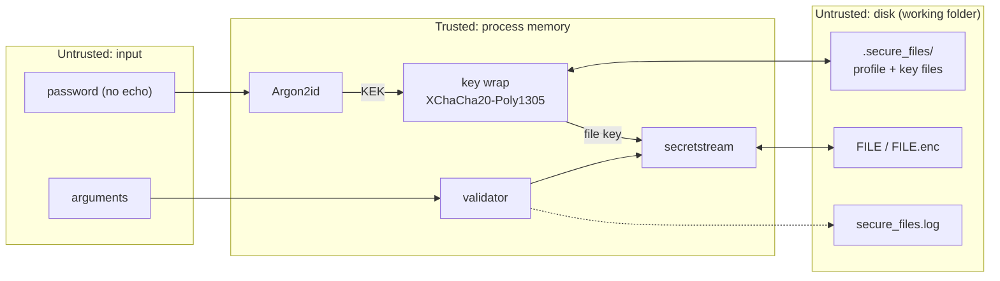

# Architecture and Data Flow

One C17 program (`secure_files/main.c`) using libsodium. Each run executes one command.

## Keys

`password → Argon2id → KEK → unwraps master key (USER.profile) → unwraps file key (USER.keys/ID.key) → decrypts FILE.enc`

- Every file has its own random key. Deleting its key file makes the `.enc` file impossible to decrypt.
- All keys are held in locked memory and wiped after use. Core dumps are disabled.

## On disk

All of these live in `./.secure_files/`: folders `0700`, files `0600`.

| File | Bytes | Contents |
|---|---|---|
| `USER.profile` | 88 | salt, nonce, wrapped master key, tag |
| `USER.keys/ID.key` | 72 | nonce, wrapped file key, tag |
| `FILE.enc` | 44 + data | `SF01`, file ID, stream header, then 64 KiB chunks with a tag each |

## Trust boundaries

- **Input:** the user name must equal your login. Paths must be relative, without `..`.
- **Disk:** all secret data is authenticated, files are checked on the open handle, and existing outputs are never
  overwritten.
- **Other users:** private folders and files, and you must own the input file.
- **Memory:** locked buffers, wiped after use.

## Flows

- **init:** password → Argon2id → wrap a new master key → write the profile.
- **encrypt:** password → new file key → write the key file → write `FILE.enc` → delete `FILE`.
- **decrypt:** password → unwrap the file key → write `FILE`, checking each chunk.
- **shred:** password → overwrite and delete the key file and `FILE.enc`.

## Libraries

libsodium 1.0.18 only: audited and hard to misuse. OpenSSL was not used because it is larger and easier to misuse.
