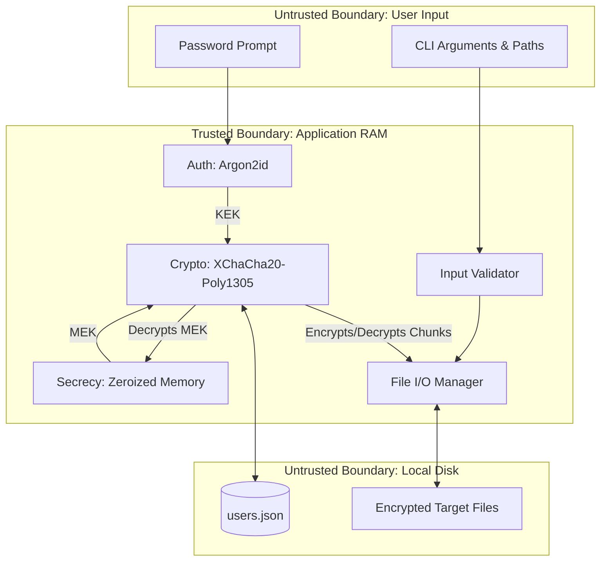

# Architecture & Data Flow

## 1. Architecture Diagram



## 2. Trust Boundaries
* **Trusted (Application RAM):** Plaintext passwords and Master Encryption Key (MEK) exist here. Protected by Rust's ownership model and active memory zeroization (`secrecy` crate).
* **Untrusted (Local Disk):** Hostile environment. All stored data (`users.json`, files) requires Authenticated Encryption (Poly1305) to detect tampering.
* **Untrusted (User Input):** Hostile environment. CLI args and paths undergo strict canonicalization to prevent injection and traversal.

## 3. Core Components
* **Input Validator:** Enforces strict allowlists; resolves absolute canonical paths; rejects out-of-bound symlinks.
* **Auth Module:** Handles secure password prompting (no echo); derives Key Encryption Key (KEK) via Argon2id.
* **Crypto Engine:** Generates random Nonces and unique Data Encryption Keys (DEKs) via CSPRNG; performs AEAD encryption/decryption.
* **File I/O Manager:** Streams file reads/writes in fixed 4MB chunks to prevent memory exhaustion (DoS).

## 4. Disk Layout
**User Metadata (`~/.sfe/users.json`)**
```json
{
  "username": "alice",
  "salt": "<Base64 128-bit Salt>",
  "argon2_params": "m=65536,t=3,p=4",
  "mek_nonce": "<Base64 192-bit Nonce>",
  "encrypted_mek": "<Base64 Ciphertext + Poly1305 Tag>"
}
```

**Encrypted Target File**
* **Bytes 0-24:** 192-bit XChaCha20 Nonce.
* **Bytes 24-56:** Unique DEK (encrypted by MEK).
* **Bytes 56-72:** 128-bit Poly1305 Tag.
* **Bytes 72+:** Encrypted file chunks.

## 5. Data Flows
* **Auth:** Password + Salt $\rightarrow$ Argon2id $\rightarrow$ KEK $\rightarrow$ Decrypt MEK $\rightarrow$ Zeroize KEK $\rightarrow$ Store MEK in secure RAM.
* **Encryption:** Canonicalize path $\rightarrow$ Generate DEK/Nonce $\rightarrow$ Encrypt DEK with MEK $\rightarrow$ Stream/Encrypt file chunks $\rightarrow$ Write header + ciphertext $\rightarrow$ Unlink plaintext file.
* **Secure Deletion:** Truncate first 72 bytes of target file (destroys DEK) $\rightarrow$ Ciphertext becomes permanent noise (Crypto-shredding) $\rightarrow$ Standard OS delete.